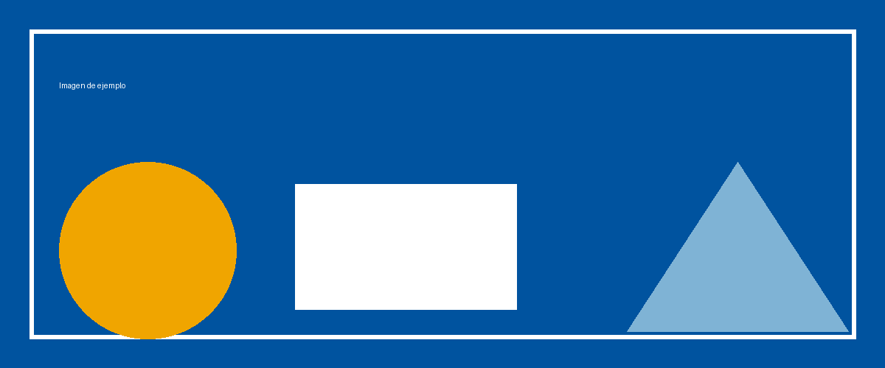

# Enlaces

Puedes añadir enlaces de dos formas:

- En línea: visita la [web de FPVirtual](https://fpvirtual.aragon.es).
- Como referencia: consulta la [documentación de pandoc][pandoc] o el
  [repositorio de la plantilla][eisvogel].

[pandoc]: https://pandoc.org
[eisvogel]: https://github.com/Wandmalfarbe/pandoc-latex-template

Los enlaces se muestran en naranja corporativo y son pulsables en el PDF
resultante.

# Imágenes

Las imágenes se referencian con **rutas relativas** al documento Markdown.
Sube el `.md` junto con las imágenes en el formulario de la aplicación y
pandoc las incorporará al PDF.

Las imágenes más anchas que la página se escalan automáticamente para
ajustarse al ancho del texto.

Formatos admitidos: **PNG, JPG, GIF, WebP, SVG y BMP**.

## Consejos

- Usa nombres de archivo sin espacios ni tildes (`captura-ejemplo.png` en
  lugar de `mi captura (1).png`).
- Si el documento va a tener portada corporativa, sube también
  `logo-cdfp.png` y `portada-fondo.png` (descargables desde la página de
  ayuda) junto con el `.md`.
